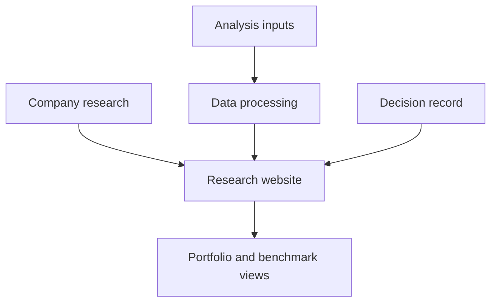

# Toffel Capital

Investment research, portfolio analysis, and a written record of the reasoning behind decisions.

[Read the case study](CASE_STUDY.md) · [Architecture](#architecture) · [Publication scope](PUBLICATION.md)

## The question behind the chart

A portfolio chart shows movement. Understanding it also requires context: the comparison being made, the period being examined, and the reasoning behind a decision.

Toffel Capital brings those questions into the same research workflow. Company analysis sits alongside portfolio views, benchmark comparisons, and a decision record, so the reader can move between what happened and why a position was considered.

## The research workflow

| View | What the reader should understand |
| --- | --- |
| Company research | The investment argument and its supporting analysis |
| Portfolio analysis | How the holdings behave over the selected period |
| Benchmark comparison | The reference used to interpret that behavior |
| Decision record | The reasoning behind a portfolio change |

Selecting a period changes the question being asked. A comparison is useful only when its labels, calculations, and explanation refer to the same period. That relationship is a central review concern for this project.

## Architecture

The private application uses **Next.js and TypeScript**, with data processing kept separate from presentation.

The diagram describes the responsibilities covered by the application. It is a reading guide, rather than a trace of a live account connection.

## Design decisions

**Keep reasoning close to the result.** A change in a chart needs an explanation that the reader can inspect. Research and decision records give the analysis somewhere to return to.

**Separate calculation from display.** Data preparation and analysis belong outside the components that present the result. That separation makes a calculation easier to review without having to interpret the entire interface.

**Make the comparison explicit.** A benchmark supplies context only when the reader understands what is being compared and over which period.

The [case study](CASE_STUDY.md) examines these choices, the questions a reviewer should ask, and the limits of the public evidence.

## Scope and contribution

This publication documents the application and its design. Source code, financial data, research attachments, screenshots, and development history remain private. It provides no runnable application or public performance claim.

AI assisted with implementation, debugging, tests, and documentation. This editorial review does not establish current runtime behavior. [Publication policy](PUBLICATION.md)
